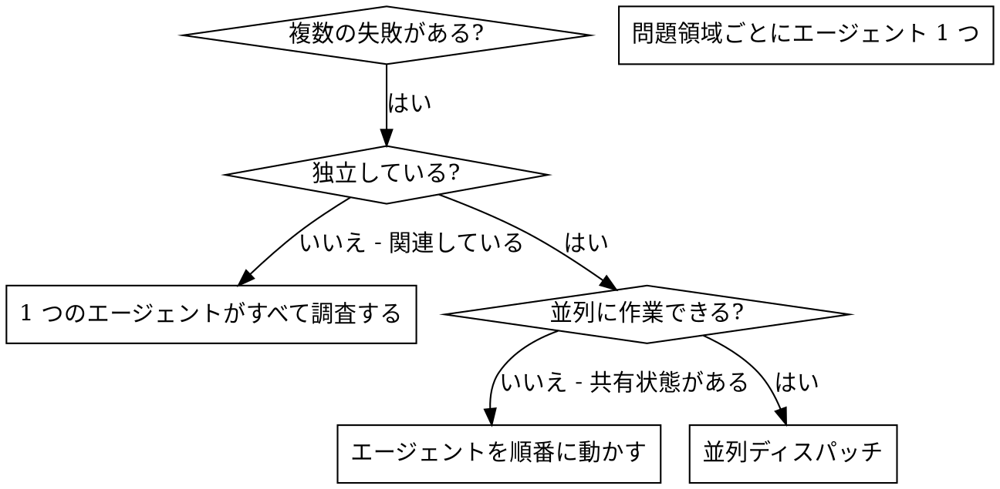

# 並列エージェントのディスパッチ

## 概要

タスクを、隔離されたコンテキストを持つ専門のエージェントに委任します。指示とコンテキストを精密に整えることで、エージェントは集中を保ち、タスクを成功させられます。エージェントにあなたのセッションのコンテキストや履歴を引き継がせてはいけません — 必要なものだけを正確に組み立てて渡します。これは、あなた自身のコンテキストを全体の取りまとめのために温存することにもなります。

無関係な失敗が複数ある場合（異なるテストファイル、異なるサブシステム、異なるバグ）、順番に調査するのは時間の無駄です。それぞれの調査は独立しており、並列に進められます。

**基本原則:** 独立した問題領域ごとにエージェントを 1 つディスパッチします。それらを並列に作業させます。

## 使うとき



**次のときに使います:**
- 3 つ以上のテストファイルが、異なる根本原因で失敗している
- 複数のサブシステムが、それぞれ独立して壊れている
- どの問題も、ほかの問題の文脈なしに理解できる
- 調査どうしの間で共有状態がない

**次のときは使わないでください:**
- 失敗が関連している（1 つを直すとほかも直るかもしれない）
- システム全体の状態を理解する必要がある
- エージェントどうしが互いに干渉する

## パターン

### 1. 独立した領域を特定する

何が壊れているかで失敗をグループ化します:
- ファイル A のテスト: ツール承認フロー
- ファイル B のテスト: バッチ完了の挙動
- ファイル C のテスト: 中断機能

各領域は独立しています - ツール承認を直しても、中断のテストには影響しません。

### 2. 焦点を絞ったエージェントのタスクを作る

各エージェントに渡すもの:
- **具体的な範囲:** テストファイル 1 つ、またはサブシステム 1 つ
- **明確なゴール:** これらのテストを通す
- **制約:** ほかのコードを変更しない
- **期待する出力:** 見つけたことと直したことの要約

### 3. 並列にディスパッチする

3 つの subagent のディスパッチを、すべて同じ応答の中で発行します — それらは並列に実行されます:

```text
Subagent (general-purpose): "agent-tool-abort.test.ts の失敗を直す"
Subagent (general-purpose): "batch-completion-behavior.test.ts の失敗を直す"
Subagent (general-purpose): "tool-approval-race-conditions.test.ts の失敗を直す"
# All three run concurrently.
```

1 つの応答に複数のディスパッチ呼び出し = 並列実行。1 応答に 1 つ = 順次実行。

### 4. レビューして統合する

エージェントが戻ってきたら:
- それぞれの要約を読む
- 修正が衝突しないことを確認する
- テストスイート全体を実行する
- すべての変更を統合する

## エージェントのプロンプトの構造

良いエージェントのプロンプトは次のようになっています:
1. **焦点が絞られている** - 明確な問題領域が 1 つ
2. **自己完結している** - 問題を理解するのに必要な文脈がすべてある
3. **出力について具体的** - エージェントが何を返すべきか

```markdown
src/agents/agent-tool-abort.test.ts で失敗している 3 つのテストを直してください:

1. "should abort tool with partial output capture" - メッセージに 'interrupted at' が含まれることを期待している
2. "should handle mixed completed and aborted tools" - 完了するはずの高速なツールが中断されてしまう
3. "should properly track pendingToolCount" - 3 件の結果を期待しているが 0 件になる

これらはタイミング/競合状態の問題です。あなたのタスクは次のとおりです:

1. テストファイルを読み、各テストが何を検証しているかを理解する
2. 根本原因を特定する - タイミングの問題か、実際のバグか
3. 次の方法で直す:
   - 決め打ちのタイムアウトを、イベントベースの待機に置き換える
   - 中断の実装にバグが見つかれば直す
   - テストが変更後の挙動を検証しているなら、テストの期待値を調整する

タイムアウトを延ばすだけにしてはいけません - 本当の問題を見つけてください。

返すもの: 見つけたことと直したことの要約。
```

## よくある間違い

**❌ 広すぎる:** 「テストをすべて直して」 - エージェントが迷子になる
**✅ 具体的:** 「agent-tool-abort.test.ts を直して」 - 焦点の絞られた範囲

**❌ 文脈がない:** 「競合状態を直して」 - エージェントはどこを見ればよいか分からない
**✅ 文脈がある:** エラーメッセージとテスト名を貼り付ける

**❌ 制約がない:** エージェントがすべてをリファクタリングするかもしれない
**✅ 制約がある:** 「本番コードを変更してはいけません」または「テストだけを直してください」

**❌ あいまいな出力:** 「直して」 - 何が変わったか分からない
**✅ 具体的:** 「根本原因と変更内容の要約を返して」

## 使ってはいけないとき

**関連する失敗:** 1 つを直すとほかも直るかもしれない - まず一緒に調査する
**全体の文脈が必要:** 理解するにはシステム全体を見る必要がある
**探索的なデバッグ:** まだ何が壊れているか分からない
**共有状態:** エージェントどうしが干渉する（同じファイルを編集する、同じリソースを使う）

## セッションでの実例

**シナリオ:** 大規模なリファクタリングの後、3 つのファイルにまたがって 6 件のテストが失敗

**失敗:**
- agent-tool-abort.test.ts: 3 件の失敗（タイミングの問題）
- batch-completion-behavior.test.ts: 2 件の失敗（ツールが実行されない）
- tool-approval-race-conditions.test.ts: 1 件の失敗（実行回数 = 0）

**判断:** 独立した領域 - 中断のロジック、バッチ完了、競合状態はそれぞれ別

**ディスパッチ:**
```
Agent 1 → agent-tool-abort.test.ts を直す
Agent 2 → batch-completion-behavior.test.ts を直す
Agent 3 → tool-approval-race-conditions.test.ts を直す
```

**結果:**
- Agent 1: タイムアウトをイベントベースの待機に置き換えた
- Agent 2: イベント構造のバグを直した（threadId が誤った場所にあった）
- Agent 3: 非同期のツール実行が完了するまで待つ処理を追加した

**統合:** すべての修正が独立しており、衝突なし、スイート全体がグリーン

## 検証

エージェントが戻ってきたら:
1. **それぞれの要約を確認する** - 何が変わったかを理解する
2. **衝突を確認する** - エージェントが同じコードを編集していないか
3. **スイート全体を実行する** - すべての修正を合わせても正しく動くことを確認する
4. **抜き打ちで確認する** - エージェントは同じ種類の間違いを繰り返すことがある
