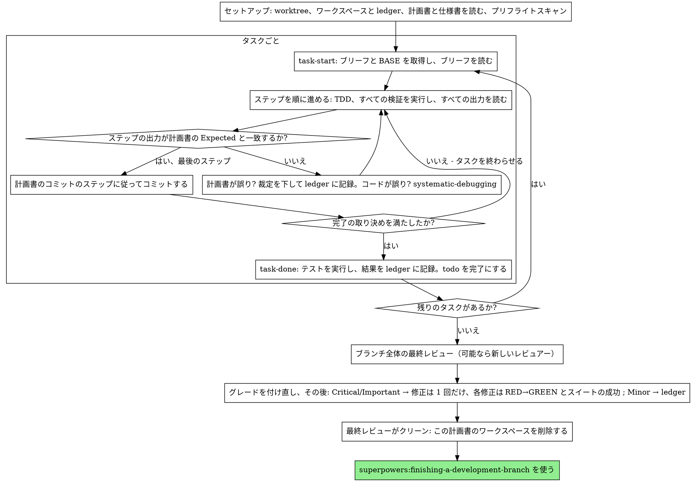

# 計画書の実行

計画書は、このセッションで自分自身がタスクごとに実行します。タスクごとの実装者 subagent も、タスクごとのレビュアーもありません。最後にブランチ全体を、新しいコンテキストで 1 回レビューします。

**なぜインラインか:** Subagent-driven development では、タスクごとに新しい実装者と新しいレビュアーのコストを払い、それぞれがコードベースを一から読み直します。インライン実行で払うのは、1 つのコンテキスト（あなたのもの）と、最後のレビュアー 1 人分だけです。手放すのは、タスクごとの新しいコンテキストと、タスクごとの第二の目です。このスキルは、その 2 つが与えていたものを別の手段で保ちます。ブリーフが仕様であり、ledger があなたの記憶であり、TDD がタスクごとのゲートであり、最終レビュアーが第二の目です。

**基本原則:** 計画書はすでに考える作業を済ませています。そのとおりに実行してください。各ステップは、まず失敗することを確認してから通したテストで証明し、あなた自身が忘れても残る記録を残してください。

**ナレーション:** ツール呼び出しの間にナレーションするのは、多くても短い 1 行までにします。記録は ledger とツールの結果が担います。

**連続実行:** タスクの合間に人間のパートナーへ確認を取るために止まってはいけません。パートナーがインライン実行を選んだのはコストを抑えるためであり、タスクごとに「続けますか?」と答えるためではありません。計画書のすべてのタスクを、止まらずに実行してください。

**止まるのではなく、裁定を下す。** 衝突、曖昧さ、計画書の欠陥 — これらは自分で決めてください。仕様書が拘束力のある権威であり、計画書はその論証であり、どちらにも答えがないことは、あなたの判断で決めます。下した決定はすべて、ledger に `Ruling: <what you decided> — <why> — <what it costs if wrong>` として記録し、先に進んでください。ledger に裁定を記録せずに計画書から逸脱するのは、密かに下した決定です。

止まるべき場合は次の 4 つだけで、これ以外にはありません。不可逆または破壊的な操作。セキュリティ上重要な操作。この worktree の外に及ぶ副作用のうち、慣例として先に確認を取るべきもの（マージ、共有ブランチへのプッシュ、公開）。そして、どの進み方も当てずっぽうになるほど壊れている計画書。これらの場合は、止まって尋ねてください。

## 使うとき

- superpowers:writing-plans で作った計画書があり、引き継ぎの場面で人間のパートナーがインライン実行を選んだ。
- ハーネスに subagent ツールがない（プラットフォームごとのリファレンスは `../using-superpowers/references/` を参照）。ディスパッチをでっち上げてはいけません。ここで計画書を実行してください。
- タスクがおおむね独立している — superpowers:subagent-driven-development と同じ前提条件です。

完全に仕様化された計画書なら、インライン実行は書き写しとテストになります。これは中位のセッションモデルでもうまく機能します。最も高性能なモデルがコストに見合うのは最終レビューだけで、それはこのスキルが別にディスパッチします。インライン実行が選ばれたときは、人間のパートナーにそのことを伝えてください。

人間のパートナーがタスクごとにレビューのゲートを求める場合や、計画書が長く、後半のタスクがコンテキスト圧縮後のコンテキストで走ることになる場合は、superpowers:subagent-driven-development を選んでください。長い計画書をインラインで実行することも可能で、ledger があるから復旧できます。ただし、最後のほうのタスクには、あなたの力が最も行き届かなくなります。

## プロセス

## セットアップ

作業が隔離されたワークスペースで行われるようにします。superpowers:using-git-worktrees を使って作成するか、既存のものを確認してください。人間のパートナーの明示的な同意なしに、main/master ブランチで実装を始めてはいけません。

会話の記憶はコンテキスト圧縮を越えて残りません。現在地を見失ったインライン実行者は、コミットがすでに存在するタスクを再実装してしまいます。コントローラーがタスクを再ディスパッチしてしまうのと同じ失敗で、そのコストを自分のコンテキストで払うことになります。進捗は todo だけでなく、ledger ファイルで追跡してください。ハーネスの todo はリアルタイムの表示であり、記録は ledger です。

ワークスペースと ledger は superpowers:subagent-driven-development と共有します — 同じディレクトリ、同じ形式です。そのため、計画書の途中で実行者を替えても、新しい実行者は同じ ledger から再開できます。

- 各計画書は 1 つのワークスペースを持ちます。スキルの開始時に、実行している作業ツリーから、
  `../subagent-driven-development/scripts/sdd-workspace PLAN_FILE` を絶対パスで
  実行してください。これは、この計画書の git 管理対象外のディレクトリ
  （`<repo-root>/.superpowers/sdd/<plan-basename>/`）を出力します。そこには、この計画書に関する
  すべての成果物 — ledger、ブリーフ、レビューパッケージ — が置かれます。
  別の計画書のディレクトリは、あなたが読み書きしてよいものではありません。
- この計画書の ledger が `<workspace>/progress.md` にあるか確認します。最初の行があなたの
  計画書ファイルを指していれば、`Task <N>: complete` の行があるタスクは完了
  済み（DONE）です — やり直してはいけません。その行がない最初のタスクから再開してください。それらの
  コミットを作った記憶がコンテキストに残っていなくても、コミットは git に存在します。
  コンテキスト圧縮の後は、自分の記憶より ledger と `git log` を信頼してください。最初の行が
  別の計画書ファイルを指している ledger は、別の計画書の進捗です。手を付けず、
  自分の ledger を新しく作ってください。
- ledger は、最初の行に自分の識別情報を書いて作ります:
  `# SDD ledger — plan: <plan file path>`。
- `git clean -fdx` はワークスペースを破壊します（git 管理対象外の作業用ディレクトリのためです）。
  そうなったら、`git log` から復旧してください。

計画書を一度読み、その文脈と Global Constraints を把握して、タスクごとに todo を作ります。計画書が Spec を挙げているなら、それも読んでください。仕様書は計画書が論拠とする権威であり、計画書の内部で衝突があれば仕様書に照らして解決します。到達できる仕様書がない計画書については、その旨を ledger に書き留めます — その状態で下した裁定は暫定です。

**必須サブスキル:** Task 1 の前に、superpowers:test-driven-development を今ロードしてください。これは、以下のすべてのタスクのすべてのステップを律します。ステップがすでに「まず失敗するテストを書く」と言っている計画書でも、これを読むことが免除されるわけではありません。

Task 1 の前に、計画書を走査してタスク間の衝突を探します。どこを見ればよいかは、計画書の Interfaces ブロックが示しています。先行タスクが生み出したものを使うタスクごとに、ledger に 1 行を書きます — 2 つのタスク、一方が生み出すものと他方が使うものの対比、そして見つけたことです。何も共有しないタスクには行を書きません。タスクが何も共有しない計画書には、`Pre-flight: no shared interfaces` という 1 行だけを書きます。行から見つかった衝突は、仕様書を拘束力のある権威として裁定し、その裁定を該当の行の横に記録して、Task 1 を始めます。各タスク自身の本文は、ここではなく、そのブリーフを読むときに確認します。

## タスクループ

あなたが出力するものとツールの結果はすべて、セッションの残りの間、コンテキストに残り続けます。長いテスト出力はワークスペース内のファイルにリダイレクトして、その末尾を読んでください。読むのはブリーフであり、計画書全体ではありません。

### 1. タスクを取る

- このスキルの `scripts/task-start PLAN_FILE N` を、実行している作業ツリーから絶対パスで実行します。
  ブリーフのパスと BASE（そのタスクの範囲を切り出すコミット）を 1 回の呼び出しで出力します。
  セットアップで覚えているタスクも含め、すべてのタスクでブリーフを読んでください。
  覚えているのは要約であり、ブリーフに正確な値、シグネチャ、テストケースがあります。
- そのタスクの todo を in_progress にします。

ツール呼び出しはすべて、コンテキスト全体を読み直すターンです。事務作業は作業に便乗させてください。ledger への追記は、コミットと同じ呼び出しの中で行い、単独の呼び出しにしてはいけません。

### 2. ステップを進める

計画書のステップはすでに RED-GREEN の順に並んでいます。セットアップでロードした superpowers:test-driven-development のもとで、その順に従ってください。テストのステップのコードは先に書き、先に実行します。失敗するのを見届けることは形式ではなく、1 つのステップです — 実装がまだないのに通るテストは、そのテスト自体に問題があるという指摘の対象です。

コマンドを実行するステップには、必ず `Expected:` 行があります。コマンドを実行し、その出力を読み、比較してください。結果は次の 3 つです:

- **一致する。** 次のステップへ進みます。
- **コードが誤り。** superpowers:systematic-debugging を使います。原因を見つけてください。ステップの出力に合わせるために症状にパッチを当ててはいけません。
- **計画書が誤り** — ステップが仕様書と矛盾している、先行タスクのインターフェースがこのタスクの使うものと合わない、動作し得ないコマンドがある。仕様書を満たす最小の変更を裁定し、
  `Task <N>: Ruling: <finding> — <what you decided and why>` として ledger に記録して、
  続けてください。裁定は記憶ではなく記録として引き継ぎます。同じインターフェースに触れる後続のタスクは、ledger からそれを読みます。

計画書のコミットのステップに従ってコミットします。複数のコミットにまたがるタスクでも問題ありません。レビュー範囲を切り出す基点は BASE であり、`HEAD~1` ではありません。

### 3. 完了の取り決め

タスクの ledger 行を書く前に、次のすべてが真でなければなりません。証拠はこのセッションで得たものであり、diff が正しそうに見えることから推測したものではありません:

- ブリーフが挙げるすべてのテストが存在し、このタスクの中で実行され、その出力を読んだ。
- タスクの最終テスト実行が通った — `task-done` がその実行であり、コマンドと結果を ledger の行に書き込む。
- ブリーフのすべての `Expected:` 行を、実際の出力と比較した。
- ブリーフからのすべての逸脱について、ledger に `Ruling:` 行がある。

**必須サブスキル:** 主張については superpowers:verification-before-completion に従います。項目が 1 つでも欠けていれば、そのタスクは完了していません。終わらせてください。

### 4. タスクを完了する

このスキルの `scripts/task-done PLAN_FILE N BASE -- <test command>` を、実行している作業ツリーから絶対パスで実行します。テストコマンドには、ブリーフがタスク全体に対して挙げているものを使ってください。これはテストを実行し、完全な出力をワークスペースに保存し、末尾を表示し、テストが通った場合にだけ、完了の行を ledger に追記します:

`Task <N>: complete (commits <base7>..<head7>, tests: <command> → <result>)`

失敗した実行は何も記録しません。そのタスクは完了していません。記録されたら、todo を完了にして、次のタスクに進みます。

## 最終レビュー

`../subagent-driven-development/scripts/review-package PLAN_FILE MERGE_BASE HEAD` を、
実行している作業ツリーから絶対パスで実行し（MERGE_BASE = ブランチが始まったコミット。例:
`git merge-base main HEAD`）、出力されたファイルからレビューします。

**subagent ツールがある場合:** 利用できる最も高性能なモデルでレビュアーをディスパッチします — ブランチ全体のレビューは判断を要するタスクです。superpowers:requesting-code-review の
[code-reviewer.md](../requesting-code-review/code-reviewer.md) を使い、
パッケージのパス、計画書と仕様書のパス、計画書に Review Focus セクションがあればそれをそのまま
（計画書のテストが検証していない入力の種類と失敗モード — レビュアーはそれぞれを意図的に確認します）、
そして、あなたが下した判断をレビュアーが評価できるように、ledger の `Ruling:` 行への案内を渡します。
モデルは明示的に指定してください。モデルを省略すると、セッションのモデルを継承し、それが最も
高性能とは限りません。この実行全体で新しいコンテキストが得られるのは、この 1 回だけです。
省略してはいけません。また、あなた自身が diff を読むことで代替してはいけません。

**subagent ツールがない場合:** code-reviewer.md を読み、パッケージに対してそのレビューを自分で
行います。最後のタスクの ledger 行の後の、別個のパスとして行ってください。ledger に
`Final review: self-review (no subagent tool)` と書き、最終メッセージでもそのことを伝えます。
作者によるセルフレビューは新しいレビュアーより弱く、それで足りるかどうかはマージの前に
人間のパートナーが判断します。

指摘のどれかに対応する前に、まず指摘を仕分けます。レビュアーの重大度ラベルは助言であり、どの指摘を修正の対象にするかを決めるのはあなたです。レビュアーの「判断を見送った事項」（"Declined to judge"）のリストもあなたのものです。そこに並ぶ各行は、計画書の衝突とまったく同じように、あなたが下して ledger に記録する裁定です — `Final: Ruling: <behavior the reviewer set aside> —
<what a reasonable person using this software gets, and why that stands
or why it is now a finding> — <cost if wrong>`。まず、影響でグレードを付け直します。
仕様書はビジョンを示す文書であり、指摘のグレードは、そのコードが出荷されたときに、このソフトウェアを使う常識的な人が受ける影響で決まります。
それを引き起こす入力を仕様書が挙げているかどうかではありません。仕様書が黙っているからという理由で
指摘を Minor にしたレビュアーは、影響ではなく仕様書にグレードを付けたのです。そのうえで:

- **Critical と Important** は修正の対象です。
- **Minor** は `Final: minor (deferred): <one-liner>` として ledger に、
  また最終メッセージの「先送りした Minor」の下に記録します。Minor は修正の対象に
  決してならず、裁定にもなりません — 裁定とは衝突についての決定であり、細かな改善の提案を
  断ったことの記録ではありません。

Critical と Important の指摘は、あなた自身が — ここでは実装者です — 1 回の修正で直します。
各修正は 2 人目のレビュアーではなく、TDD で検証します。指摘を再現するテストを書き、
失敗するのを見届け、通るようにしてから、スイート全体を実行します。それぞれを ledger に
`Final: fixed <finding> — <test name> RED→GREEN, suite <N>/<N>` として記録します。
先に失敗したテストのない修正は、検証されていません。修正の後でスイートが成功していなければ、
修正はまだ終わっていません。再レビューをディスパッチしてはいけません。対応できたことはテストが、何も壊れていないことは
スイートの実行がすでに示しており、再レビューはその diff を読み直すだけだからです。

直さないと決めた指摘は裁定です — `Final: Ruling: <finding> —
<why the code stands> — <cost if wrong>` — そして、裁定の一覧として人間のパートナーに届きます。
2 回目の修正はありません。

## 完了

何かを削除する前に、`Ruling:` を含む ledger の行をすべて、最終メッセージの「自分が下した裁定」の
下に、下した順に、誤っていた場合のコストを添えて集めます。`minor (deferred)` の行もすべて
「先送りした Minor」の下に集めます。どちらの一覧も網羅的でなければなりません。あなたが
人間のパートナーに代わって下した決定と、対応しないと選んだ指摘をパートナーに届ける手段は、
あなたの最終メッセージしかありません。

最終レビューに問題がなく、その修正がコミットされたら、この計画書のワークスペース
ディレクトリを削除します — 今や記録は git の履歴です。兄弟ディレクトリは別の計画書のものです。
手を付けないでください。

superpowers:finishing-a-development-branch を使います。

## よくある自己正当化

| 言い訳 | 現実 |
|--------|------|
| 「Task N に何が書いてあるかは覚えている」 | 覚えているのは要約です。ブリーフに正確な値があります。読んでください。 |
| 「計画書のコードは正しいから、テストが失敗するのを見るのは省略しよう」 | 失敗するのを見たことがないテストは何も証明しません。それは 1 つのステップです。実行してください。 |
| 「ステップごとではなく、最後にスイート全体を実行しよう」 | ステップごとの実行は、どのステップが壊したかを知る方法です。タスク終了時の実行は取り決めであり、代わりにはなりません。 |
| 「ここは計画書が間違っているから、正しいことをやってしまおう」 | 正しいことをして、裁定を ledger に記録してください。記録されない逸脱は、密かに下した決定です。 |
| 「ledger の行は数タスクの後にまとめて書こう」 | コンテキスト圧縮は都合のよい時を待ってくれません。タスクごとに 1 行、コミットと同じメッセージの中で書いてください。 |
| 「次のタスクの前に確認を取ろう」 | パートナーがインラインを選んだのはコストを抑えるためです。進捗の確認はパートナーの時間を奪います。止まるのは、4 つの停止条件のときだけです。 |
| 「自分の diff は丁寧に読んだから、最終レビュアーは不要だ」 | 同じ作者、同じ死角です。レビュアーは、この実行が得られる唯一の新しいコンテキストです。 |
| 「テストは通るはずだ、変更は些細だった」 | 「はず」は証拠ではありません。取り決めが求めるのは、コマンドとその出力です。 |
| 「subagent は遅くて高いから、最終レビューも省略しよう」 | インラインはすでにタスクごとのレビュアーを取り除いています。ブランチ全体の 1 回のレビューは上限ではなく下限です。 |
| 「レビュアーが Minor と言ったから Minor だ」 | そのラベルは仕様書の沈黙にグレードを付けたものです。利用者が受ける影響にグレードを付けてください。グレードを付け直してから、どの指摘を修正の対象にするかを決めます。 |
| 「修正は明白だから、先に失敗するテストは要らない」 | 失敗するテストだけが、その指摘が本物であり、今はなくなったという証明です。それがなければ、あるのは diff と願いだけです。 |
| 「ついでに Minor も直しておこう」 | 直した Minor はどれも、パートナーが求めていないテスト、修正、スイート実行になります。ledger に記録してください。判断するのはパートナーです。 |
