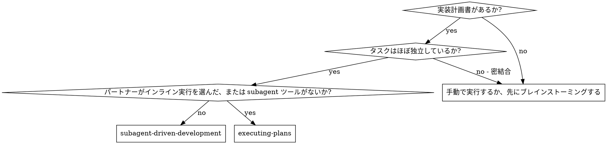
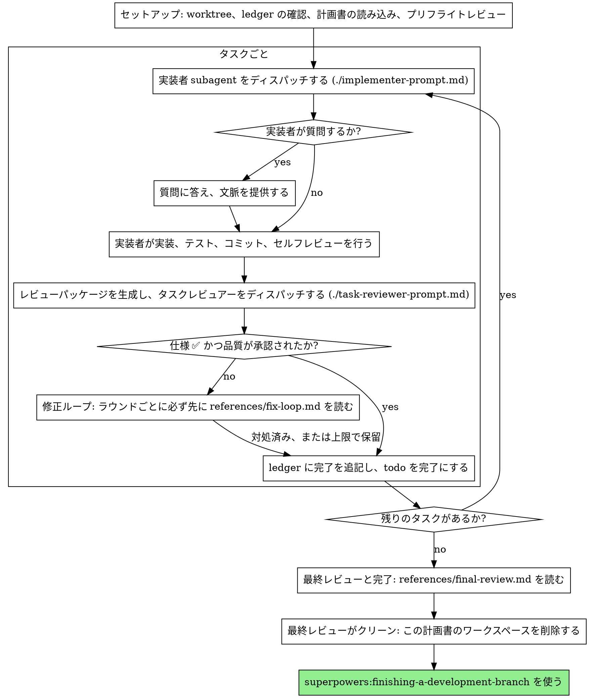

# Subagent-Driven Development

タスクごとに新しい実装者 subagent をディスパッチし、各タスクの後にタスクレビュー（仕様準拠 + コード品質）を行い、最後に広範な whole-branch レビューを行うことで、計画書を実行します。

**subagent を使う理由:** 隔離されたコンテキストを持つ専門のエージェントに、タスクを委任します。指示と文脈を精密に組み立てることで、エージェントは焦点を保ち、タスクを成功させられます。エージェントは、あなたのセッションの文脈や履歴を決して引き継ぐべきではありません — 必要なものだけを、あなたが正確に組み立てて渡します。これは、あなた自身のコンテキストを調整の作業のために温存することにもなります。

**基本原則:** タスクごとに新しい subagent + タスクレビュー（仕様 + 品質）+ 広範な最終レビュー = 高品質で、高速な反復

**語り:** ツール呼び出しの合間に語るのは、短い 1 行までにしてください。記録を担うのは
ledger とツールの結果です。

**継続実行:** タスクの合間に、人間のパートナーへ確認のために止まらないでください。計画書のすべてのタスクを、止まらずに実行してください。止まってよい理由は、下に挙げる 4 つか、すべてのタスクの完了だけです。「続けてよいですか？」という問いかけや進捗サマリは相手の時間を無駄にします — 彼らは計画書を実行するよう頼んだのですから、実行してください。

**止まるのではなく、裁定する。** 実行中の計画書は、人間を待ちません。矛盾、曖昧さ、計画書の欠陥、
上限を超える許可を求めたくなるような状況 — それらは、あなたが決めてください。仕様書が拘束力を持つ
権威であり、計画書はその論拠であり、どちらも答えを持たないことはあなたの判断が決着をつけます。
すべての決定を、`Ruling: <what you decided> — <why> — <what it costs if wrong>` として ledger に
記録し、進み続けてください。誤った裁定のコストは、人間のパートナーが目にして取り消せる手戻りです。
質問で止まったセッションのコストは、彼らの丸 1 日であり、何も得られません。

あなたを止めるのは次の 4 つだけです。不可逆または破壊的な操作。セキュリティ上機微な行為。
この worktree の外への副作用で、慣例として先に確認を取るべきもの（マージ、共有ブランチへの push、
公開）。そして、どの道を進んでも当て推量になるほど壊れた計画書。これらについては、
止まって質問してください。

## 使うとき

**Executing Plans（インライン）との比較:**
- 1 つのコンテキストがすべてのタスクをこなす代わりに、タスクごとに新しい subagent を使う（コンテキストの汚染なし）
- 最後にだけレビューする代わりに、各タスクの後にレビューする（仕様準拠 + コード品質）
- タスクごと・レビューごとに新しいコンテキストのコストがかかる。インラインのコストは、1 つのコンテキストに最終レビュアー 1 つ分
- どちらもこのセッションで実行し、同じ計画書のワークスペースと ledger を共有し、タスクの合間に止まらない

## プロセス

## セットアップ

作業が隔離されたワークスペースで行われるようにしてください。
superpowers:using-git-worktrees を使って作成するか、既存のものを検証します。
人間のパートナーの明示的な同意なしに、main/master ブランチで実装を始めてはいけません。

会話の記憶は、コンテキスト圧縮を越えて残りません。実際のセッションでは、自分の位置を見失った
コントローラーが、完了済みのタスク列全体を再ディスパッチしました — 観察された中で最も高くつく
失敗です。進捗は、todo だけでなく ledger ファイルに記録してください。

- 各計画書が自分のワークスペースを持ちます。スキルの開始時に、このスキルの
  `bash scripts/sdd-workspace PLAN_FILE` を絶対パスで、実行中の作業ツリーから実行してください —
  その計画書の git 無視されたディレクトリ（`<repo-root>/.superpowers/sdd/` の下）が出力されます。
  そこが、この計画書のすべての成果物 — ledger、ブリーフ、レポート、レビューパッケージ — の置き場所です。
  別の計画書のディレクトリを、読んだり書いたりしてはいけません。
- この計画書の ledger が `<workspace>/progress.md` にあるか確認してください。あれば、何よりも先に
  [references/resuming.md](references/resuming.md) を読んでください。誰の ledger か、どこから
  再開するかが書かれています。
- ledger を作るときは、1 行目にその識別情報を書いてください:
  `# SDD ledger — plan: <plan file path>`。
- ledger は復旧のための地図です。そこに書かれたコミットは、あなたのコンテキストがそれを作った
  ことをもう覚えていなくても、git に存在します。コンテキスト圧縮の後は、自分の記憶より ledger と
  `git log` を信頼してください。
- `git clean -fdx` はワークスペースを破壊します（git 無視された作業用の置き場所です）。
  そうなったら、`git log` から復旧してください。

計画書を 1 回読み、その文脈と Global Constraints を書き留め、タスクごとに todo を作ってください。
計画書が Spec を名指ししているなら、それも読んでください。仕様書は計画書が論拠とする権威であり、
計画書内の矛盾は仕様書に照らして解決します。到達できる仕様書がない計画書には、その旨を ledger に
メモしてください — 仕様書なしで下した裁定は暫定のものです。

Task 1 をディスパッチする前に、[references/preflight.md](references/preflight.md) を読み、そこに
書かれた矛盾のスキャンを実行してください。その表と裁定は ledger に書きます。

## モデル選択

コストを抑え、速度を上げるために、各役割をこなせる最も非力なモデルを使ってください。

**機械的な実装タスク**（独立した関数、明確な仕様、1〜2 ファイル）: 高速で安価なモデルを使います。計画書が仕様が十分に定められていれば、実装タスクの大半は機械的です。

**統合と判断のタスク**（複数ファイルの調整、パターンマッチング、デバッグ）: 標準的なモデルを使います。

**アーキテクチャと設計のタスク**: 利用可能な最も高性能なモデルを使います。
最終の whole-branch レビューはその 1 つです — セッションのデフォルトではなく、
利用可能な最も高性能なモデルでディスパッチしてください。

**レビューのタスク**: 同じ判断でモデルを選び、diff の大きさ、複雑さ、リスクに応じて調整します。
小さな機械的な diff に最も高性能なモデルは要りませんが、微妙な並行処理の変更には必要です。
小さな修正 diff に対するスコープ付き再レビューには、安価〜中位のティアを使います。

**修正ループのエスカレーション（ラウンド 4〜5）**: 行き詰まった実装者より少なくとも 1 ティア
上のモデルを使います。

**subagent をディスパッチするときは、必ずモデルを明示的に指定してください。** モデルを省略すると
セッションのモデル — 多くの場合、最も高性能で最も高価なもの — を継承し、この節が暗黙のうちに
無意味になります。

**ターン数はトークン単価に勝ります。** 実時間とコンテキストのコストは、subagent が取る
ターン数に比例して増えます。そして最も安価なモデルは、複数ステップの作業では日常的に
2〜3 倍のターン数を要し、全体ではかえって高くつきます。レビュアーと、散文の説明をもとに作業する
実装者には、中位のティアを下限として使ってください。タスクの計画書の記述に、書くべきコードが
完全に含まれているなら、実装は転記とテストです。その実装者には最も安価なティアを使ってください。
単一ファイルの機械的な修正も、最も安価なティアを使います。

**タスクの複雑さのシグナル（実装タスク）:**
- 1〜2 ファイルに触れ、仕様が完全 → 安価なモデル
- 統合上の懸念がある複数ファイルに触れる → 標準的なモデル
- 設計上の判断や広範なコードベースの理解が必要 → 利用可能な最も高性能なモデル

## タスクループ

**小さな同型の作業:** 計画書に、ファイルをまたぐ同種の小さな編集が複数並んでいるときは、
ディスパッチする前に [references/batching.md](references/batching.md) を読んでください。

ディスパッチ用プロンプトに貼り付けるものはすべて、そして subagent が出力して返すものはすべて、
セッションの残りの間あなたのコンテキストに残り、以降のターンのたびに読み直されます。
成果物はファイルとして渡してください。

**ディスパッチした subagent を待つとき:** 短いタイムアウトで待機インターフェースをポーリング
してはいけません。また、無言で終わりの定まらない待機に座り込んでもいけません。手元の作業 —
ledger の更新、次のレビューのパッケージ化、レポートの読み込み — があるなら、それを続けてください。
子の結果は勝手に届きます。本当に手が空いているなら、区切られた時間で待ってください
（プラットフォームが許す限り、5〜10 分）。そして区切りの合間に、状況を 1 行投稿し、生きている
子を突き合わせてください。一覧を出し、報告せずに終わったものを追いかけます。区切られた待機は、
長い待機の効率のほぼすべてを保ちつつ、詰まった子や行方不明の子がセッションの最後ではなく
数分以内に気づかれることを保証します。

### 1. 実装者をディスパッチする

ディスパッチする前に BASE（`git rev-parse HEAD`）を記録してください — レビューパッケージと
修正ラウンドの diff にこれが必要です。

- **タスクブリーフ:** 実装者をディスパッチする前に、このスキルの
  `bash scripts/task-brief PLAN_FILE N` を絶対パスで、実行中の作業ツリーから実行してください —
  タスクの全文を一意な名前のファイルに取り出し、そのパスを出力します。ブリーフが要件の唯一の
  情報源であり続けるように、ディスパッチを組み立ててください。ディスパッチに含めるのは:
  (1) このタスクがプロジェクトのどこに位置するかを 1 行、(2) ブリーフのパス。「これを最初に読んで
  ください — あなたの要件であり、逐語的に使うべき正確な値が書かれています」と紹介します、
  (3) ブリーフが知り得ない、以前のタスクからのインターフェースと決定、(4) ブリーフに気づいた
  曖昧さについてのあなたの解決、(5) レポートファイルのパスと報告の契約。正確な値（数値、
  マジック文字列、シグネチャ、テストケース）は、ブリーフにだけ現れます。subagent に計画書
  ファイル全体を読ませてはいけません。
- **レポートファイル:** 実装者のレポートファイルは、ブリーフにならって名づけ
  （ブリーフ `…/task-N-brief.md` → レポート `…/task-N-report.md`）、ディスパッチ用プロンプトに
  書いてください。実装者は完全なレポートをそこに書き、ステータス、コミット、テストの 1 行
  サマリ、懸念だけを返します。
- ディスパッチ用プロンプトが記述するのは 1 つのタスクであり、セッションの履歴ではありません。
  それまでのタスクの要約を積み重ねたもの（「Task 1〜3 の後の状態」）を、後のディスパッチに
  貼り付けてはいけません — 実際のセッションのディスパッチは 4 万 2 千文字に達し、その 99% が
  貼り付けられた履歴でした。新しい subagent に必要なのは、そのタスク、触れるインターフェース、
  グローバル制約です。それ以外は不要です。
- ディスパッチには、subagent をディスパッチしないという契約が含まれます（実装者テンプレートに
  あります）。実装者は、補助であっても、ましてレビュアーであっても、subagent を決して
  ディスパッチしません。レビューは、報告の後にあなたから届きます。実際のセッションでは、
  ワーカーが起動したレビュアーはすべて、コントローラーがどのみちディスパッチしたタスクレビューを
  重複させました — タスクごとに、レビューの席が丸ごと 1 つ余分にかかったのです。
- 以前のタスクが、このタスクが触れる領域で指摘を保留していたなら、その ledger の記録への
  ポインタをディスパッチに添えてください。
- ディスパッチ結果から、実装者のエージェント ID を記録してください — 修正ループのラウンド 1〜3 で
  このエージェントを再開します。
- 複数の実装 subagent を並列にディスパッチしてはいけません（衝突します）。

テンプレート: [implementer-prompt.md](implementer-prompt.md)

### 2. 報告を処理する

実装者 subagent は、4 つのステータスのいずれかを報告します。それぞれを適切に処理してください。

**DONE:** レビューパッケージを生成し（`bash scripts/review-package PLAN_FILE BASE HEAD` を絶対パスで、実行中の作業ツリーから実行します — 書き出された一意のファイルパスが出力されます。BASE は、実装者をディスパッチする前に記録したコミットです — `HEAD~1` は決して使わないでください。複数コミットのタスクでは、最後のコミット以外が黙って落ちます）、出力されたパスを添えてタスクレビュアーをディスパッチしてください。

**それ以外のステータス**（DONE_WITH_CONCERNS、NEEDS_CONTEXT、BLOCKED）:
[references/handling-reports.md](references/handling-reports.md) を読んで、それに従ってください。
受け取るたびに毎回です。

実装者が質問してきたら — 開始前でも作業の途中でも — 明確かつ完全に答え、必要なら追加の文脈を
提供し、実装へ急かさないでください。

### 3. タスクをレビューする

タスクごとのレビューは、タスク単位のゲートです。広範なレビューは、最後の whole-branch レビューで
1 回だけ行われます。タスクレビューを決してスキップしてはいけません。また、どちらかの判定が
欠けた報告を決して受け入れてはいけません — 仕様準拠とタスク品質の両方が必須です。実装者の
セルフレビューがタスクレビューの代わりになることは決してありません。両方が必要です。

- レビュアーには、diff をファイルとして渡してください。このスキルの
  `bash scripts/review-package PLAN_FILE BASE HEAD` を絶対パスで、実行中の作業ツリーから実行し、
  出力されたファイルパスをレビュアーに渡します（bash がない場合は、その範囲の `git log --oneline`、
  `git diff --stat`、`git diff -U10` を、一意な名前の 1 つのファイルにリダイレクトします）。
  出力があなた自身のコンテキストに入ることはなく、レビュアーはコミット一覧、stat のサマリ、
  文脈つきの完全な diff を 1 回の Read で見られます。実装者をディスパッチする前に記録した BASE を
  使ってください — `HEAD~1` は決して使わないでください。複数コミットのタスクが黙って切り詰められます。
  diff ファイルなしでタスクレビュアーをディスパッチしてはいけません。
- **レビュアーへの入力:** タスクレビュアーが受け取るパスは 3 つ — 同じブリーフファイル、
  レポートファイル、レビューパッケージ — と、そのタスクを拘束するグローバル制約です。
- レビュアーに渡すグローバル制約のブロックは、そのレビュアーの注意のレンズです。拘束力のある要件を、
  計画書の Global Constraints 節または仕様書から逐語的にコピーしてください: 正確な値、正確な形式、
  コンポーネント間で述べられた関係（「X と同じレイアウト」「Y に一致」）。レビュアーのテンプレートは
  すでにプロセスのルール（YAGNI、テストの衛生、レビューの方法）を持っています — 制約ブロックは、
  このプロジェクトの仕様書が要求することのためのものです。
- 具体的でタスク固有の理由なしに、「すべての使用箇所を確認する」や「有用なら race テストを実行する」
  のような、終わりの定まらない指示を加えてはいけません
- 実装者が同じコードですでに実行したテストを、レビュアーに再実行させてはいけません — 実装者の
  レポートがテストの証拠を持っています
- レビュアーのために指摘を事前判断してはいけません — 特定の問題を無視するよう、あるいは指摘しない
  よう、レビュアーに指示してはいけません。指摘が誤検知だと思うなら、レビュアーに挙げさせ、
  レビューループの中で裁定してください。書いているプロンプトに「指摘しないこと」「X を欠陥として
  扱わないこと」「せいぜい Minor」「計画書がそう選んだ」が含まれているなら — 止まってください。
  あなたは事前判断をしています。たいていは、自分がレビューループを回す手間を省くためです。
レビュアーが「⚠️ Cannot verify from diff」項目を報告したら、タスクを完了にする前に
[references/cannot-verify.md](references/cannot-verify.md) を読んでください。

テンプレート: [task-reviewer-prompt.md](task-reviewer-prompt.md)

### 4. 修正ループ

レビューが仕様 ❌、Critical または Important の指摘、あるいはあなたが実際の不足だと確認した ⚠️ 項目を
報告したとき、ループが発動します。

発動したら、[references/fix-loop.md](references/fix-loop.md) を読んで、それに従ってください。
このセッションで前に読んだことがあっても、ラウンドごとにもう一度読んでください。ラウンドの上限、
ブレーカー、各ラウンドが書く ledger 行がそこにあり、あなたのそれについての記憶は
コンテキスト圧縮を越えて残らないからです。

### 5. タスクを完了する

レビューがクリーンで返ってきたとき — あるいはすべての未解決の指摘が上限で裁定つきで保留された
とき — ほかの記録作業と同じメッセージの中で、完了行を ledger に追記してください。

- `Task <N>: complete (commits <base7>..<head7>, review clean)`
- ブレーカーが発動した後は `Task <N>: complete (commits <base7>..<head7>, <K> parked)`

その後、todo を完了にして先へ進んでください。レビューに Critical/Important の未解決の問題があり、
それが修正されておらず、上限で裁定つきで保留されてもいない間は、決して次のタスクへ進んでは
いけません。

## 最終レビュー

すべてのタスクが完了したら、[references/final-review.md](references/final-review.md) を読んで、
それに従ってください。whole-branch レビュー、その 1 回きりの修正の波、そして完了のしかたが
書かれています。

## よくある自己正当化

| 言い訳 | 現実 |
|--------|------|
| 「仕様準拠は十分に近い」 | レビュアーが仕様の不足を見つけた = 完了していません。修正するか、上限に達して裁定するかです — 出口はその 2 つだけです。 |
| 「自分で直すほうが早い。ディスパッチはオーバーヘッドだ」 | コントローラーによる修正はコンテキストを汚し、レビューを飛ばします。実装者を再開してください。 |
| 「もう 1 ラウンドで収束するだろう」 | 上限を過ぎると、ラウンドは収束しません — 失敗は構造的なものです。裁定して、進路を振り分けてください。 |
| 「どうせレビュアーはまた何か新しいものを見つける」 | スコープ付き再レビューは修正を検証するもので、さまよってはいけません。触れていないコードの新たな指摘は、ループではなく ledger に行きます。 |
| 「この指摘は明らかに間違っている。落とそう」 | 裁定するのは上限に達したときだけで、すべての裁定は ledger の記録です。黙って捨てることは禁止です。 |
| 「修正は小さかった。再レビューは飛ばそう」 | レビューされていない修正が、リグレッションが入り込む経路です。どのラウンドも、スコープ付き再レビューで終わります。 |
| 「レビューはループを遅くする」 | レビューのないループは、検証されない空回りにすぎません。レビューはループのブレーキであり、舵です。 |
| 「ledger の記録はオーバーヘッドだ」 | コンテキスト圧縮を越えて残るのは ledger です。ledger のないコントローラーは、完了済みのタスク列全体を再ディスパッチしたことがあります。 |
| 「実装者が自分でレビュアーを起動した — 余分な保証がただで手に入る」 | 同じ diff をレビューする重複の席です。ゲートはタスクレビューです。ワーカーが起動したレビュアーは、厳密さではなく、指摘すべき欠陥です。 |
