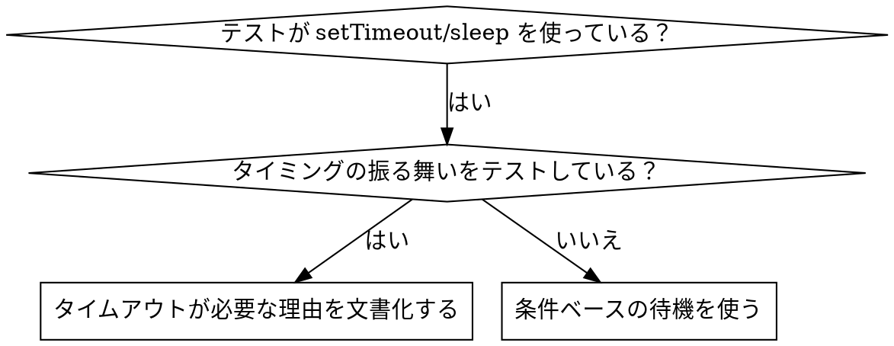

# 条件ベースの待機

## 概要

不安定な（flaky な）テストは、決め打ちの遅延でタイミングを当て推量していることがよくあります。これは競合状態を生み、速いマシンでは通るのに、負荷がかかったときや CI では失敗するテストになります。

**基本原則:** 時間がどれくらいかかるかの当て推量ではなく、実際に気にしている条件を待ってください。

## 使うとき



**次のときに使います:**
- テストに決め打ちの遅延がある（`setTimeout`、`sleep`、`time.sleep()`）
- テストが不安定（通ることもあれば、負荷がかかると失敗する）
- 並列で実行するとテストがタイムアウトする
- 非同期操作の完了を待っている

**次のときは使わないでください:**
- 実際のタイミングの振る舞いをテストしている（debounce、throttle の間隔）
- 根拠のない固定タイムアウトを使うなら、その理由を必ず文書化する

## 基本パターン

```typescript
// ❌ BEFORE: Guessing at timing
await new Promise(r => setTimeout(r, 50));
const result = getResult();
expect(result).toBeDefined();

// ✅ AFTER: Waiting for condition
await waitFor(() => getResult() !== undefined);
const result = getResult();
expect(result).toBeDefined();
```

## 手早く使えるパターン

| シナリオ | パターン |
|----------|----------|
| イベントを待つ | `waitFor(() => events.find(e => e.type === 'DONE'))` |
| 状態を待つ | `waitFor(() => machine.state === 'ready')` |
| 件数を待つ | `waitFor(() => items.length >= 5)` |
| ファイルを待つ | `waitFor(() => fs.existsSync(path))` |
| 複雑な条件 | `waitFor(() => obj.ready && obj.value > 10)` |

## 実装

汎用のポーリング関数:
```typescript
async function waitFor<T>(
  condition: () => T | undefined | null | false,
  description: string,
  timeoutMs = 5000
): Promise<T> {
  const startTime = Date.now();

  while (true) {
    const result = condition();
    if (result) return result;

    if (Date.now() - startTime > timeoutMs) {
      throw new Error(`Timeout waiting for ${description} after ${timeoutMs}ms`);
    }

    await new Promise(r => setTimeout(r, 10)); // Poll every 10ms
  }
}
```

実際のデバッグセッションで使った、ドメイン固有のヘルパー（`waitForEvent`、`waitForEventCount`、`waitForEventMatch`）を含む完全な実装は、このディレクトリの `condition-based-waiting-example.ts` を参照してください。

## よくある間違い

**❌ ポーリングが速すぎる:** `setTimeout(check, 1)` - CPU を無駄にする
**✅ 修正:** 10ms ごとにポーリングする

**❌ タイムアウトがない:** 条件が満たされないと永遠にループする
**✅ 修正:** 明確なエラーを伴うタイムアウトを必ず入れる

**❌ 古いデータ:** ループの前に状態をキャッシュしてしまう
**✅ 修正:** ループの内側でゲッターを呼び、新しいデータを取得する

## 決め打ちのタイムアウトが正しいとき

```typescript
// Tool ticks every 100ms - need 2 ticks to verify partial output
await waitForEvent(manager, 'TOOL_STARTED'); // First: wait for condition
await new Promise(r => setTimeout(r, 200));   // Then: wait for timed behavior
// 200ms = 2 ticks at 100ms intervals - documented and justified
```

**要件:**
1. まず、きっかけとなる条件を待つ
2. 既知のタイミングに基づく（当て推量ではない）
3. なぜかを説明するコメントを付ける

## 実際の影響

デバッグセッション（2025-10-03）より:
- 3 つのファイルにまたがる 15 件の不安定なテストを修正した
- 通過率: 60% → 100%
- 実行時間: 40% 短縮
- 競合状態は解消した
