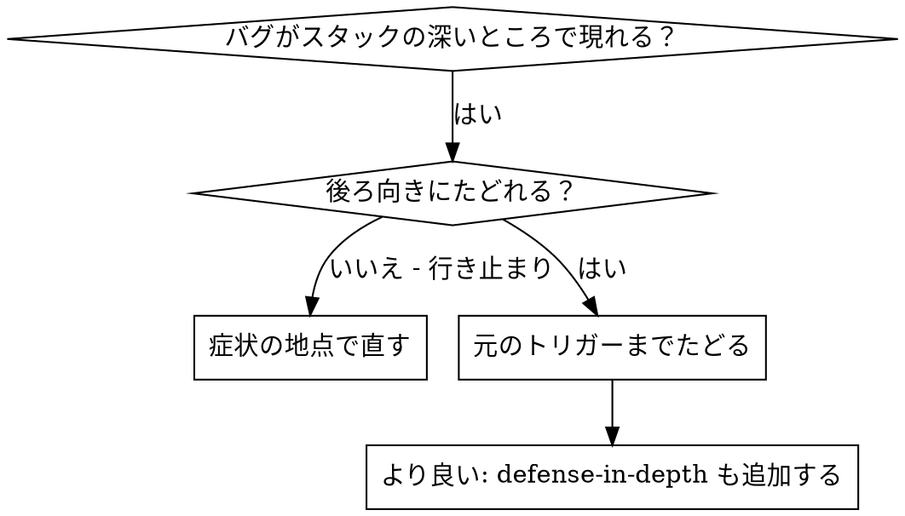
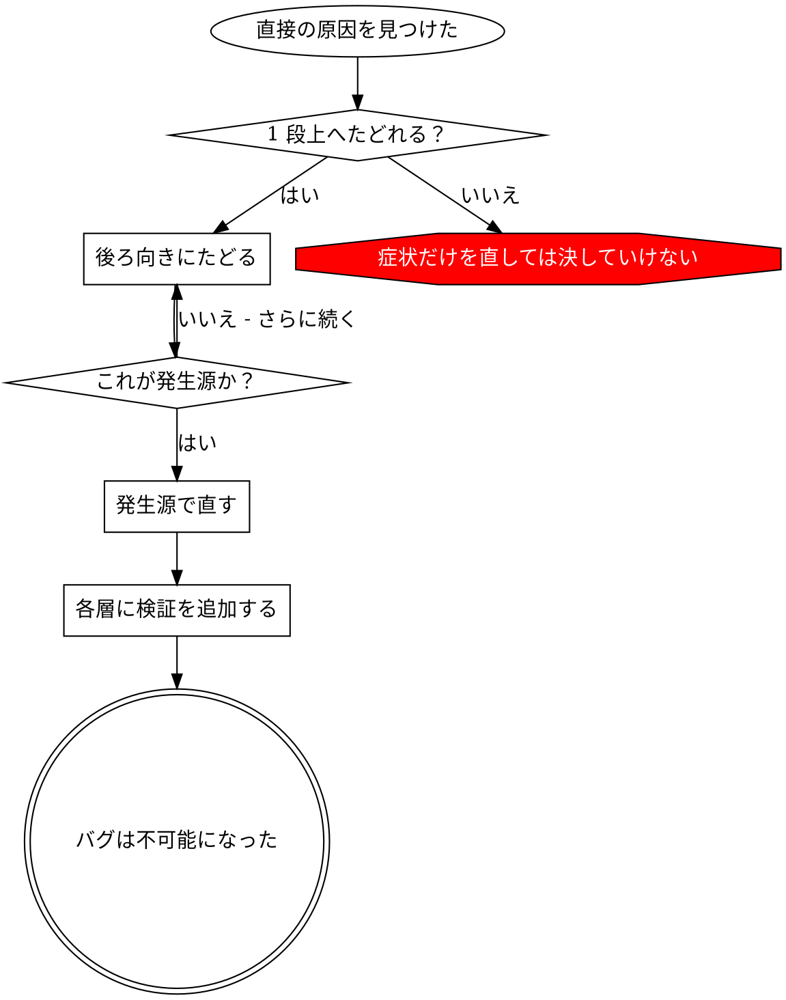

# 根本原因のトレース

## 概要

バグは、コールスタックの深いところで現れることがよくあります（間違ったディレクトリでの git init、間違った場所に作られたファイル、間違ったパスで開かれたデータベースなど）。エラーが現れた場所で直したくなりますが、それは症状への対処です。

**基本原則:** 元のトリガーを見つけるまで呼び出しチェーンを後ろ向きにたどり、発生源で直してください。

## 使うとき



**次のときに使います:**
- エラーが実行の深いところで起きる（エントリポイントではない）
- スタックトレースが長い呼び出しチェーンを示している
- 無効なデータがどこで生まれたのか不明
- どのテスト/コードが問題を引き起こしているのか突き止める必要がある

## トレースのプロセス

### 1. 症状を観察する
```
Error: git init failed in ~/project/packages/core
```

### 2. 直接の原因を見つける
**どのコードがこれを直接引き起こしているか？**
```typescript
await execFileAsync('git', ['init'], { cwd: projectDir });
```

### 3. 問う: これを呼び出したのは何か？
```typescript
WorktreeManager.createSessionWorktree(projectDir, sessionId)
  → called by Session.initializeWorkspace()
  → called by Session.create()
  → called by test at Project.create()
```

### 4. 上へたどり続ける
**どんな値が渡されたか？**
- `projectDir = ''`（空文字列！）
- 空文字列を `cwd` に渡すと `process.cwd()` として解決される
- それはソースコードのディレクトリだ！

### 5. 元のトリガーを見つける
**空文字列はどこから来たか？**
```typescript
const context = setupCoreTest(); // Returns { tempDir: '' }
Project.create('name', context.tempDir); // Accessed before beforeEach!
```

## スタックトレースの追加

手作業でたどれないときは、計装を追加します:

```typescript
// Before the problematic operation
async function gitInit(directory: string) {
  const stack = new Error().stack;
  console.error('DEBUG git init:', {
    directory,
    cwd: process.cwd(),
    nodeEnv: process.env.NODE_ENV,
    stack,
  });

  await execFileAsync('git', ['init'], { cwd: directory });
}
```

**最重要:** テストでは `console.error()` を使います（logger は表示されないことがあるため使いません）

**実行して取得する:**
```bash
npm test 2>&1 | grep 'DEBUG git init'
```

**スタックトレースを分析する:**
- テストファイル名を探す
- 呼び出しを引き起こしている行番号を見つける
- パターンを特定する（同じテストか？ 同じパラメータか？）

## どのテストが汚染を起こしているかの特定

テスト中に何かが現れるが、どのテストが原因か分からないとき:

このディレクトリの二分探索スクリプト `find-polluter.sh` を使います:

```bash
bash ./find-polluter.sh '.git' 'src/**/*.test.ts'
```

テストを 1 つずつ実行し、最初に汚染を起こすテストで止まります。使い方はスクリプトを参照してください。

## 実例: 空の projectDir

**症状:** `.git` が `packages/core/`（ソースコード）に作られた

**トレースの連鎖:**
1. `git init` が `process.cwd()` で実行される ← cwd パラメータが空
2. WorktreeManager が空の projectDir で呼び出された
3. Session.create() が空文字列を渡した
4. テストが beforeEach より前に `context.tempDir` にアクセスした
5. setupCoreTest() は最初 `{ tempDir: '' }` を返す

**根本原因:** トップレベルの変数初期化が、空の値にアクセスしていた

**修正:** tempDir を、beforeEach より前にアクセスされると例外を投げるゲッターにした

**defense-in-depth も追加した:**
- 層 1: Project.create() がディレクトリを検証する
- 層 2: WorkspaceManager が、空でないことを検証する
- 層 3: NODE_ENV のガードが、tmpdir の外での git init を拒否する
- 層 4: git init の前にスタックトレースをログに記録する

## 重要な原則



**エラーが現れた場所だけを直してはいけません。** 元のトリガーを見つけるまでさかのぼってください。

## スタックトレースのヒント

**テストでは:** logger ではなく `console.error()` を使う - logger は抑制されることがある
**操作の前に:** 危険な操作が失敗した後ではなく、その前にログを出す
**コンテキストを含める:** ディレクトリ、cwd、環境変数、タイムスタンプ
**スタックを記録する:** `new Error().stack` は呼び出しチェーン全体を示す

## 実際の影響

デバッグセッション（2025-10-03）より:
- 5 段階のトレースで根本原因を見つけた
- 発生源（ゲッターでの検証）で直した
- 4 層の防御を追加した
- 1847 件のテストが通り、汚染はゼロになった
