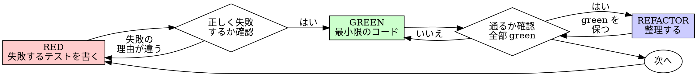

# Test-Driven Development (TDD)

## 概要

先にテストを書きます。失敗するのを確認します。通す最小限のコードを書きます。

**基本原則:** テストが失敗するのを見ていなければ、そのテストが正しいものをテストしているかどうかは分かりません。

**ルールの文言に違反することは、ルールの精神に違反することです。**

## 使うとき

**常に:**
- 新機能
- バグ修正
- リファクタリング
- 振る舞いの変更

**例外（人間のパートナーに確認してください）:**
- 使い捨てのプロトタイプ
- 生成されたコード
- 設定ファイル

「今回だけ TDD を省略しよう」と考えていますか？ 止まってください。それは自己正当化です。

## 鉄則

```
失敗するテストが先にない限り、プロダクションコードを書いてはいけません
```

テストより先にコードを書きましたか？ 削除してください。最初からやり直してください。

**例外なし:**
- 「参考」として残さない
- テストを書きながらそれを「適応」させない
- 見ない
- 削除は削除を意味する

テストから新たに実装してください。以上です。

## Red-Green-Refactor



### RED - 失敗するテストを書く

何が起こるべきかを示す最小限のテストを 1 つ書いてください。

<Good>
```typescript
test('retries failed operations 3 times', async () => {
  let attempts = 0;
  const operation = () => {
    attempts++;
    if (attempts < 3) throw new Error('fail');
    return 'success';
  };

  const result = await retryOperation(operation);

  expect(result).toBe('success');
  expect(attempts).toBe(3);
});
```
名前が明確で、実際の振る舞いをテストしており、1 つのことだけを扱っています
</Good>

<Bad>
```typescript
test('retry works', async () => {
  const mock = jest.fn()
    .mockRejectedValueOnce(new Error())
    .mockRejectedValueOnce(new Error())
    .mockResolvedValueOnce('success');
  await retryOperation(mock);
  expect(mock).toHaveBeenCalledTimes(3);
});
```
名前が曖昧で、コードではなくモックをテストしています
</Bad>

**要件:**
- 振る舞いは 1 つ
- 名前が明確
- 実際のコード（やむを得ない場合を除きモックは使わない）

### RED の確認 - 失敗するのを見る

**必須です。決して省略してはいけません。**

```bash
npm test path/to/test.test.ts
```

次を確認してください:
- テストが失敗する（エラーではなく）
- 失敗メッセージが想定どおりである
- 機能が存在しないために失敗している（タイプミスではなく）

**テストが通りましたか？** 既存の振る舞いをテストしています。テストを直してください。

**テストがエラーになりましたか？** エラーを直し、正しく失敗するまで再実行してください。

### GREEN - 最小限のコード

テストを通す最も単純なコードを書いてください。

<Good>
```typescript
async function retryOperation<T>(fn: () => Promise<T>): Promise<T> {
  for (let i = 0; i < 3; i++) {
    try {
      return await fn();
    } catch (e) {
      if (i === 2) throw e;
    }
  }
  throw new Error('unreachable');
}
```
通すのに十分なだけです
</Good>

<Bad>
```typescript
async function retryOperation<T>(
  fn: () => Promise<T>,
  options?: {
    maxRetries?: number;
    backoff?: 'linear' | 'exponential';
    onRetry?: (attempt: number) => void;
  }
): Promise<T> {
  // YAGNI
}
```
作り込みすぎです
</Bad>

機能を追加したり、他のコードをリファクタリングしたり、テストの範囲を超えて「改善」したりしないでください。

### GREEN の確認 - 通るのを見る

**必須です。**

```bash
npm test path/to/test.test.ts
```

次を確認してください:
- テストが通る
- 他のテストも引き続き通る
- 出力がきれいである（エラーも警告もない）

**テストが失敗しましたか？** テストではなくコードを直してください。

**他のテストが失敗しましたか？** 今すぐ直してください。

**「他のテスト」とは、自分のファイルだけでなくプロジェクトのスイート全体を指します。** 自分が書いたテストが green でも、スイートが green とは限りません。変更を完了と呼ぶ前に、タスクで指定されたテストファイルが 1 つだけであっても、プロジェクトのテストコマンド（素の `pytest`、`npm test`、`cargo test` など、そのリポジトリが使うもの）を実行してください。タスクの範囲の指定は成果物の範囲を区切るものであり、検証の範囲を区切るものではありません。その実行で見つかった失敗は、自分が原因でないものも含め、名前を挙げて報告に書いてください。流れていくのを見たのに報告で触れなかった失敗したテストは、省略によって偽られた報告です。

### REFACTOR - 整理する

green になった後だけです:
- 重複を取り除く
- 名前を改善する
- ヘルパーを抽出する

テストを green に保ってください。振る舞いを追加してはいけません。

### 繰り返す

次の機能のために、次の失敗するテストを書いてください。

## 良いテスト

| 品質 | 良い | 悪い |
|------|------|------|
| **最小限** | 1 つのことだけ。名前に「and」がある？ 分割してください。 | `test('validates email and domain and whitespace')` |
| **明確** | 名前が振る舞いを説明している | `test('test1')` |
| **意図を示す** | 望ましい API を示している | コードが何をすべきかが分かりにくい |

テストを書くとき、または変更するときは、テストを正直に保つためのルールとして [writing-good-tests.md](writing-good-tests.md) を読んでください:
- テストを書く前に、そのテストを失敗させるプロダクションコードの変更を挙げる
- 実際の振る舞いに対してアサートし、モックの振る舞いに対しては決してアサートしない
- テスト専用のコードはテストユーティリティに置き、プロダクションのクラスには入れない
- モックする前に、依存先の副作用を理解する

## よくある自己正当化

| 言い訳 | 現実 |
|--------|------|
| 「単純すぎてテストは要らない」 | 単純なコードも壊れます。テストは 30 秒で書けます。 |
| 「テストは後で書く」 | 後から書いたテストは即座に通ります — それでは何も証明されません。間違ったものをテストしているかもしれず、振る舞いではなく実装をテストしているかもしれず、忘れていたエッジケースを見逃しているかもしれません。失敗するのを一度も見ていないので、バグを捕まえられると証明したことにはなりません。テストファーストはその失敗を強制します。 |
| 「後からテストしても同じ目的を達成できる（精神であって儀式ではない）」 | 後から書くテストは「これは何をするのか？」に答え、先に書くテストは「これは何をすべきか？」に答えます。後から書いたテストは、すでに書いたコードに引きずられます — 発見できたはずのケースではなく、覚えていたケースを検証することになります。テストが機能する証明のないカバレッジです。 |
| 「手動でテスト済み」 | 手動テストは場当たり的です。何をカバーしたかの記録がなく、コードが変わっても再実行できず、プレッシャーの下ではケースを忘れがちです。「試したら動いた」≠ 網羅的。自動テストは毎回同じように実行されます。 |
| 「X 時間分を削除するのはもったいない」 | サンクコストの誤謬です — その時間はどちらにしてもすでに使われています。本当の選択は、TDD で書き直す（高い確信）か、そのまま残して後からテストを継ぎ足す（低い確信、バグがありそう）かです。信頼できないコードを残すことこそ無駄です。 |
| 「参考として残して、テストを先に書く」 | それを適応させてしまいます。それは後からテストすることです。削除は削除を意味します。 |
| 「まず探索する必要がある」 | かまいません。探索したものは捨てて、TDD から始めてください。 |
| 「テストが難しい = 設計が不明確」 | テストの声を聞いてください。テストしにくいものは使いにくいのです。 |
| 「TDD は自分を遅くする」 | TDD こそ現実的な道です。コミット前にバグを捕まえ、リグレッションを防ぎ、恐れずにリファクタリングできます。「現実的」な近道は本番でのデバッグを意味します — 速くなるのではなく、遅くなります。 |
| 「手動テストのほうが速い」 | 手動ではエッジケースは証明できません。変更のたびに再テストすることになります。 |
| 「既存のコードにはテストがない」 | あなたはそれを改善しているところです。既存のコードにもテストを追加してください。 |

## 危険信号 - 止まって最初からやり直してください

- テストより先にコードがある
- 実装の後でテストを書いた
- テストが即座に通る
- テストがなぜ失敗したのか説明できない
- テストを「後で」追加する
- 「今回だけ」と自己正当化している
- 「もう手動でテストした」
- 「後からテストしても同じ目的を達成できる」
- 「精神であって儀式ではない」
- 「参考として残す」または「既存のコードを適応させる」
- 「すでに X 時間使った、削除はもったいない」
- 「TDD は教条的だ、自分は現実的に判断している」
- 「これは違う、なぜなら...」

**これらはすべて、コードを削除し、TDD で最初からやり直すことを意味します。**

## 例: バグ修正

**バグ:** 空のメールアドレスが受け付けられる

**RED**
```typescript
test('rejects empty email', async () => {
  const result = await submitForm({ email: '' });
  expect(result.error).toBe('Email required');
});
```

**RED の確認**
```bash
$ npm test
FAIL: expected 'Email required', got undefined
```

**GREEN**
```typescript
function submitForm(data: FormData) {
  if (!data.email?.trim()) {
    return { error: 'Email required' };
  }
  // ...
}
```

**GREEN の確認**
```bash
$ npm test
PASS
```

**REFACTOR**
必要なら、複数のフィールドに使えるようにバリデーションを抽出します。

## 検証チェックリスト

作業を完了とする前に:

- [ ] 新しい関数/メソッドにはすべてテストがある
- [ ] 実装する前に、各テストが失敗するのを見た
- [ ] 各テストが想定どおりの理由で失敗した（タイプミスではなく、機能がないため）
- [ ] 各テストを通す最小限のコードを書いた
- [ ] すべてのテストが通る
- [ ] 出力がきれいである（エラーも警告もない）
- [ ] テストは実際のコードを使っている（やむを得ない場合のみモック）
- [ ] エッジケースとエラーがカバーされている

すべてにチェックを入れられませんか？ TDD を省略しています。最初からやり直してください。

## 行き詰まったとき

| 問題 | 解決策 |
|------|--------|
| テストの方法が分からない | 望む API を書く。先にアサーションを書く。人間のパートナーに尋ねる。 |
| テストが複雑すぎる | 設計が複雑すぎます。インターフェースを単純にする。 |
| すべてをモックしなければならない | コードの結合が強すぎます。依存性注入を使う。 |
| テストのセットアップが巨大 | ヘルパーを抽出する。それでも複雑？ 設計を単純にする。 |

## デバッグとの統合

バグを見つけましたか？ それを再現する失敗するテストを書いてください。TDD のサイクルに従ってください。テストが修正を証明し、リグレッションを防ぎます。

テストなしでバグを修正してはいけません。

## 最終ルール

```
プロダクションコード → テストが存在し、しかも先に失敗している
そうでなければ → TDD ではない
```

人間のパートナーの許可なく例外を設けてはいけません。
