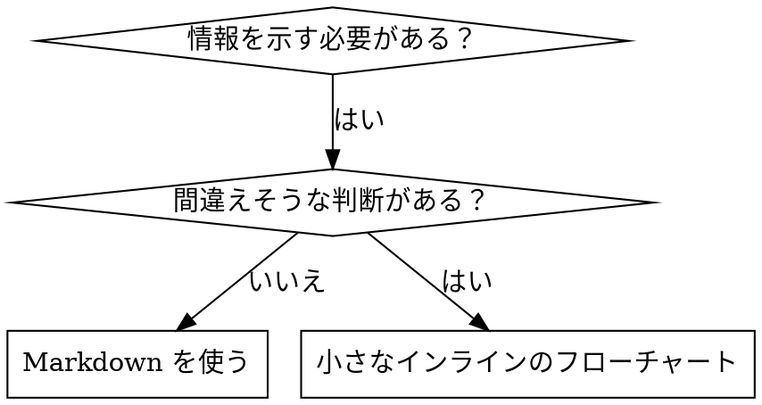

# スキルのフローチャート

superpowers:writing-skills の一部です。

## フローチャートの使い方



**フローチャートを使うのは次の場合**に限ります:
- 自明でない判断ポイント
- 早く止まりすぎるおそれのあるプロセスのループ
- 「A と B のどちらを使うか」の判断

**フローチャートを決して使わないもの:**
- リファレンス資料 → 表、リスト
- コード例 → Markdown のブロック
- 直線的な指示 → 番号付きリスト
- 意味のないラベル（step1、helper2）

graphviz のスタイルルールは、このディレクトリの `graphviz-conventions.dot` を参照してください。

**人間のパートナー向けに可視化する:** writing-skills ディレクトリにある `render-graphs.js` を使うと、スキルのフローチャートを SVG に描画できます。そのディレクトリから実行してください。
```bash
node ./render-graphs.js ../some-skill           # Each diagram separately
node ./render-graphs.js ../some-skill --combine # All diagrams in one SVG
```
